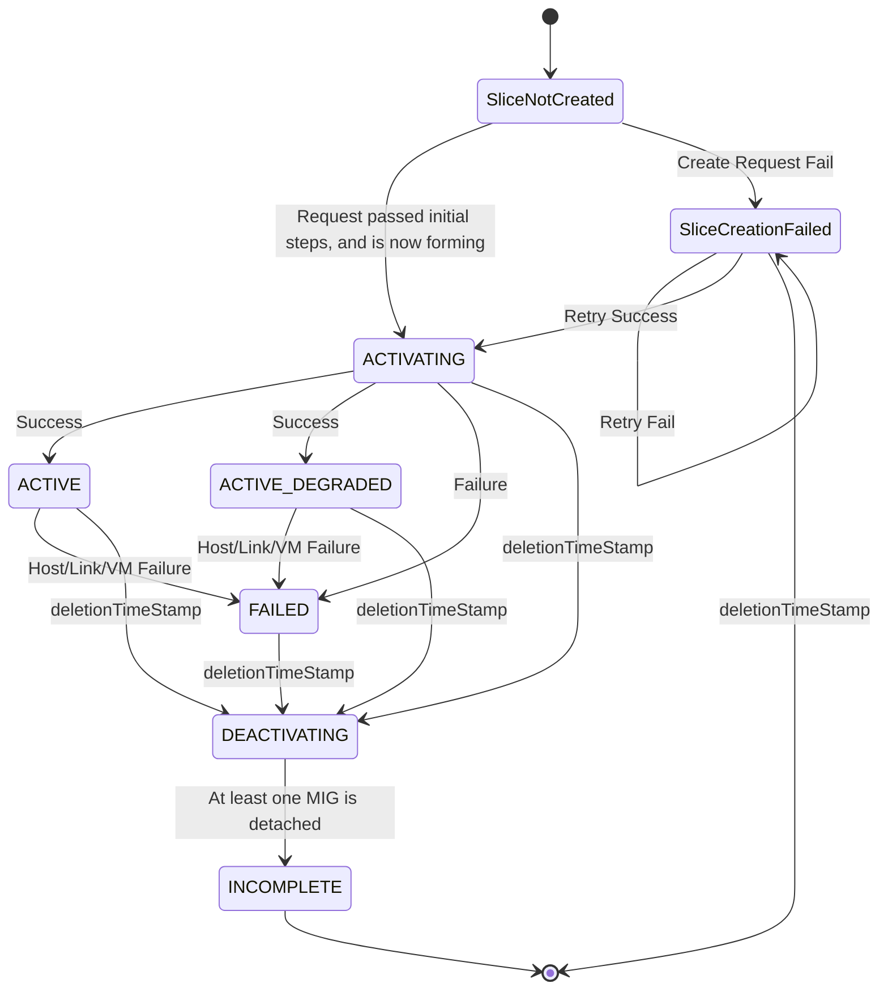

# Slice Controller

The Slice Controller is a Kubernetes controller for managing TPU slices in Google Kubernetes Engine (GKE). It introduces a `Slice` custom resource that allows users to request a slice of TPUs with a specific type and topology. The controller then interacts with the underlying cloud infrastructure to provision and configure the requested TPU slice, and monitor the slice healthiness.

> **Disclaimer:** This project is intended for demonstration purposes only. It is not intended for use in a production environment.

## Description

The Slice Controller simplifies the management of TPU slices in GKE by providing a declarative API for requesting and managing TPU resources. It implements **Dynamic Slicing**, a feature for Cluster Director clusters that decouples resource provisioning from slice formation.

Provisioning is performed in physical units called **cubes** (16-node units). Users create a `Slice` custom resource specifying the desired accelerator type and topology. The controller then dynamically stitches these cubes together by interacting with the underlying cloud infrastructure (Optical Circuit Switching network) to form the requested TPU slice, and monitors its health.

Users can track the slice formation progress and health by inspecting the CR's status fields.



## Core Concepts

### Dynamic Slicing
Dynamic Slicing is a TPU feature on GKE for Cluster Director clusters that decouples resource provisioning from slice formation. Instead of creating slices during node pool provisioning, resources are provisioned once in small units, and the Slice Controller dynamically stitches them together based on workload demands.

### Cubes
A **Cube** is the base unit of provisioning in Dynamic Slicing. Each node pool maps to a 16-node cube. Initially, these cubes do not have active TPU Inter-Chip-Interconnect (ICI) links.

### Super-slices vs. Sub-slices
Dynamic Slicing supports two distinct slice scales depending on workload requirements:

- **Super-slices (Multi-Cube / Multi-MIG)**: Large slices that span multiple 16-node cubes/partitions. The controller dynamically stitches these cubes together across the Optical Circuit Switching (OCS) network via GCE Multi-MIG (MMIG) resources.
- **Sub-slices (Intra-Node-Pool / Single-Cube)**: Smaller slices that fit within a single 16-node cube or partition. The controller configures accelerator topologies directly on the target node pool MIG without requiring Multi-MIG provisioning.

#### Supported Sub-slice Topologies
| Accelerator Type | Supported Sub-slice Topologies | Full Partition Topology |
| :--- | :--- | :--- |
| **tpu7x** (Ironwood) | `2x2x1`, `2x2x2`, `2x2x4`, `2x4x4` | `4x4x4` |

### Incremental Provisioning
Dynamic Slicing requires Incremental Provisioning. Unlike the traditional "all-or-nothing" model, if some nodes in a cube are unhealthy, the remaining healthy nodes are still provisioned. The system reconciles the state automatically as faulty hosts recover.

## CRD
```go
// +kubebuilder:resource:scope=Cluster
type Slice struct {
        metav1.TypeMeta   `json:",inline"`
        metav1.ObjectMeta `json:"metadata,omitempty"`

        Spec   SliceSpec   `json:"spec,omitempty"`
        Status SliceStatus `json:"status,omitempty"`
}

// SliceSpec defines the desired state of Slice.
type SliceSpec struct {
        // Type specifies the type of accelerator used in this slice.
        // Supported values: "tpu7x".
        // +kubebuilder:validation:Immutable
        // +kubebuilder:validation:Enum=tpu7x
        Type Type `json:"type"`

        // Topology represents the network topology of the slice.
        // It defines the physical arrangement of TPU chips.
        // The topology must be specified in `<X>x<Y>` or `<X>x<Y>x<Z>` format.
        // +kubebuilder:validation:Immutable
        // +kubebuilder:validation:Pattern=^\d+x\d+(x\d+)?$
        Topology string `json:"topology"`

        // PartitionIds denotes the set of partitions to use to form a slice.
        // For slices that span multiple partitions, it will be a list of 4x4x4 IDs.
        // +kubebuilder:validation:Immutable
        // +kubebuilder:validation:MinItems=1
        PartitionIds []string `json:"partitionIds"`
}

// SliceStatus defines the observed state of Slice.
type SliceStatus struct {
        // Conditions store the status conditions of the Slice
        // +operator-sdk:csv:customresourcedefinitions:type=status
        Conditions []metav1.Condition `json:"conditions,omitempty"`
}
```

## Slice Status Conditions

The status of a slice is tracked via conditions in the `Slice` Custom Resource (CR) status field. Specifically, the `reason` field indicates the current lifecycle state:

| Reason | Description |
| :--- | :--- |
| **SliceNotCreated** | The slice has not been created yet. The controller is initializing and performing preflight checks. |
| **SliceCreationFailed** | Creation failed because prerequisites were not met or user input validation failed. |
| **ACTIVATING** | The slice is currently in the process of being formed. |
| **ACTIVE** | The slice is fully formed, healthy, and ready to execute workloads. |
| **ACTIVE_DEGRADED** | The slice is formed but includes degraded cubes (supported via ICI resilience). |
| **DEACTIVATING** | The slice is in the process of being dismantled. |
| **FAILED** | The slice is no longer ready to execute workloads (due to formation failure or critical hardware/software failure). |
| **INCOMPLETE** | Terminal state during deformation. |

## Usage

### Creating a Slice CR
To request a TPU slice, create a `Slice` custom resource. The name of the resource must adhere to specific rules to be compatible with GCE resource naming:
- **Length**: 49 characters or less.
- **Format**: Must match `^[a-z]([-a-z0-9]*[a-z0-9])?$`.

#### Super-slice Example YAML (v1beta1)
```yaml
apiVersion: accelerator.gke.io/v1beta1
kind: Slice
metadata:
  name: test-super-slice
spec:
  type: "tpu7x"
  topology: "4x4x8"
  partitionIds:
    - a9476d1b02bd4f4e75ffffae3bd23c01
    - ba898ffcac0ad0946e8ff036d771ee53
```

#### Sub-slice Example YAML (v1beta1)
```yaml
apiVersion: accelerator.gke.io/v1beta1
kind: Slice
metadata:
  name: test-subslice
spec:
  type: "tpu7x"
  topology: "2x2x1"
  partitionIds:
    - a9476d1b02bd4f4e75ffffae3bd23c01
```

### Dynamic Slice and Sub-slice Updates
When `--enable-slice-update` or `--support-subslice-update` is enabled, the Slice Controller allows updating the `spec.partitionIds` of an existing `Slice` custom resource. This supports dynamic scaling and partition reconfiguration:
- **`0 -> N`**: Initialize or form a slice from an empty spec.
- **`N -> 0`**: Deform the slice while preserving the `Slice` custom resource.
- **`N -> M`**: Transition and reassign slice partitions dynamically.

### Auto-Retry on Failure
To enable the slice controller to automatically retry during slice formation, add the `slice.gke.io/retry-on-failure: "true"` annotation to the metadata. The default minimum retry delay is 5 seconds, and the maximum retry delay is 1 minute with standard exponential backoff.

### Workload Deployment
When deploying workloads on Dynamic Slices, you must specify the slice topology in annotations and node selectors.

#### Single Slice Job Example
```yaml
apiVersion: batch/v1
kind: Job
metadata:
  name: tpu-job
spec:
  template:
    metadata:
      annotations:
        cloud.google.com/gke-tpu-slice-topology: 4x4x8
    spec:
      nodeSelector:
        cloud.google.com/gke-tpu-topology: 4x4x8
        cloud.google.com/gke-tpu-accelerator: tpu7x
        cloud.google.com/gke-tpu-slice: test-slice
```

For multi-slice workloads, you can use **JobSet** with the `exclusive-topology` annotation.

## Metrics

The Slice Controller exposes public metrics to monitor slice and partition states. These can be viewed in the Metrics Explorer in the Google Cloud console under `kubernetes.io/accelerator/`.

| Metric Name | Description |
| :--- | :--- |
| `kubernetes.io/accelerator/slice/state` | Current state of a slice (e.g., ACTIVE, FAILED). |
| `kubernetes.io/accelerator/partition/state` | Current state of a partition (e.g., HEALTHY, UNHEALTHY). |
| `kubernetes.io/accelerator/slice/formation_durations` | Distribution of durations taken to create and assemble a TPU slice. |
| `kubernetes.io/accelerator/slice/deformation_durations` | Distribution of durations taken to tear down a TPU slice. |

## Formation/deformation flow
### Formation
- [Main reconciler] Create workload policy, wait for OP to be completed
- [Main reconciler] Create MMIG, wait for OP to be completed
- [Main reconciler] Attach MIGs to MMIG, wait for OP to be completed
- [Health monitoring] Find the MMIG to be in ACTIVE state, update the slice condition
- [Maint reconciler] Find the condition update, label the nodes

### Deformation
- [Main reconciler] Unlabel the nodes
- [Main reconciler] Trigger a MMIG deformation by detaching a single MIG, persist the OP
- [Health monitoring] Find the MMIG to be in INCOMPLETE state, update the slice condition
- [Main reconciler] Verify the pivot MIG detach OP is in completed status, if not, requeue after 5s
- [Main reconciler] Detach all MIGs from MMIG, wait for OPs to be completed
- [Main reconciler] Delete MMIG, wait for op to be completed
- [Main reconciler] Delete workload policy, wait for op to be completed

## Configuration

The Slice Controller can be configured via command-line flags passed to the binary. Below are the key configuration options:

### Concurrency Settings
| Flag | Default | Description |
| :--- | :--- | :--- |
| `--enable-high-gce-concurrency` | `true` | Enables high parallelism for slice formation and deformation. |
| `--enable-high-node-labeling-concurrency` | `true` | Enables high parallelism for node labeling and unlabeling. |
| `--slice-reconciler-worker-count` | `128` | Number of workers for the slice reconciler. |

### Retry and Rate Limiting
| Flag | Default | Description |
| :--- | :--- | :--- |
| `--min-retry-delay` | `5s` | Minimum time to wait before retrying on error. |
| `--max-retry-delay` | `60s` | Maximum time to wait before retrying on error. |
| `--workqueue-rate-limit` | `200.0` | Rate limit for the workqueue (QPS). |
| `--workqueue-burst` | `500` | Burst size for the workqueue. |

### Feature Flags
| Flag | Default | Description |
| :--- | :--- | :--- |
| `--enable-subslicing` | `true` | Enables sub-slicing support on the slice controller. |
| `--enable-slice-update` | `false` | Enables dynamic update logic for super-slices (`0->N`, `N->0`, `N->M`). |
| `--support-subslice-update` | `false` | Enables dynamic update logic for sub-slices (`0->N`, `N->0`, `N->M`). |
| `--enable-linked-runner` | `true` | Enables Linked Runner logic in the slice controller. |
| `--health-monitor-enabled` | `true` | Enables the health monitor to monitor health of MIGs and MMIGs. |
| `--health-reconciler-enabled` | `true` | Enables the health reconciler to reconcile health status. |
| `--enable-dashboard` | `false` | Enables the dashboard UI for visualizing topologies. |

## Getting Started

### Prerequisites
- go version v1.23.0+
- docker version 17.03+.
- kubectl version v1.11.3+.
- Access to a Kubernetes v1.11.3+ cluster.

### To Deploy on the cluster
**Build and push your image to the location specified by `IMG`:**

```sh
make docker-build docker-push IMG=<some-registry>/slice-controller:tag
```

**NOTE:** This image ought to be published in the personal registry you specified.
And it is required to have access to pull the image from the working environment.
Make sure you have the proper permission to the registry if the above commands don’t work.

**Install the CRDs into the cluster:**

```sh
make install
```

**Deploy the Manager to the cluster with the image specified by `IMG`:**

```sh
make deploy IMG=<some-registry>/slice-controller:tag
```

> **NOTE**: If you encounter RBAC errors, you may need to grant yourself cluster-admin
privileges or be logged in as admin.

**Create instances of your solution**
You can apply the samples (examples) from the config/sample:

```sh
kubectl apply -k config/samples/
```

>**NOTE**: Ensure that the samples has default values to test it out.

### To Uninstall
**Delete the instances (CRs) from the cluster:**

```sh
kubectl delete -k config/samples/
```

**Delete the APIs(CRDs) from the cluster:**

```sh
make uninstall
```

**UnDeploy the controller from the cluster:**

```sh
make undeploy
```

## Project Distribution

Following the options to release and provide this solution to the users.

### By providing a bundle with all YAML files

1. Build the installer for the image built and published in the registry:

```sh
make build-installer IMG=<some-registry>/slice-controller:tag
```

**NOTE:** The makefile target mentioned above generates an 'install.yaml'
file in the dist directory. This file contains all the resources built
with Kustomize, which are necessary to install this project without its
dependencies.

2. Using the installer

Users can just run 'kubectl apply -f <URL for YAML BUNDLE>' to install
the project, i.e.:

```sh
kubectl apply -f https://raw.githubusercontent.com/<org>/slice-controller/<tag or branch>/dist/install.yaml
```

### By providing a Helm Chart

1. Build the chart using the optional helm plugin

```sh
kubebuilder edit --plugins=helm/v1-alpha
```

2. See that a chart was generated under 'dist/chart', and users
can obtain this solution from there.

**NOTE:** If you change the project, you need to update the Helm Chart
using the same command above to sync the latest changes. Furthermore,
if you create webhooks, you need to use the above command with
the '--force' flag and manually ensure that any custom configuration
previously added to 'dist/chart/values.yaml' or 'dist/chart/manager/manager.yaml'
is manually re-applied afterwards.

## Reporting Security Issues

Eligibility for the [Google Open Source Software Vulnerability Rewards Program](https://bughunters.google.com/open-source-security) is determined by the [Google Open Source Software Vulnerability Reward Program Rules](https://bughunters.google.com/about/rules/open-source/google-open-source-software-vulnerability-reward-program-rules).

## Contributing

Please note: This project is currently not accepting external contributions or pull requests. Instead please open an issue and project maintainers will be in touch.

Please see [CONTRIBUTING.md](CONTRIBUTING.md) for details on setting up your development environment and running tests.

This project follows [Google's Open Source Community Guidelines](https://opensource.google/conduct/).

## License

Copyright 2025 Google LLC.

Licensed under the Apache License, Version 2.0 (the "License");
you may not use this file except in compliance with the License.
You may obtain a copy of the License at

    http://www.apache.org/licenses/LICENSE-2.0

Unless required by applicable law or agreed to in writing, software
distributed under the License is distributed on an "AS IS" BASIS,
WITHOUT WARRANTIES OR CONDITIONS OF ANY KIND, either express or implied.
See the License for the specific language governing permissions and
limitations under the License.
